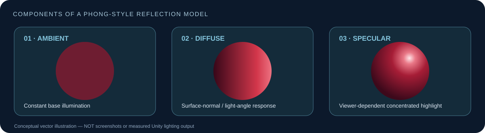
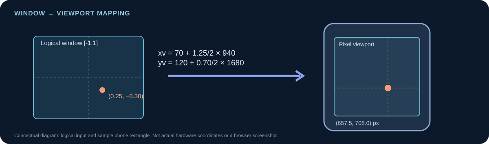

[← Repository](../README.md) · [Technical manual](../docs/MANUAL.md) · [Live browser demo ↗](https://cgvr-furniture-studio.vercel.app/) · [Evidence guide](outputs/README.md)

# Furniture Studio
### CIE3 · Case Study 3 — Retail and Remote Commerce

**CS4104 · Computer Graphics & Virtual Reality · RV University, Bengaluru**

**Student:** Munnaluri Rishikesh · **USN:** 1RVU23CSE291 · **Unity:** 6000.3.0f1

<p>
<a href="https://cgvr-furniture-studio.vercel.app/"></a>
<a href="Unity_Retail_AR_Demo/README.md"></a>
</p>

> **Project brief:** A furniture retailer wants people to preview a **red velvet chair** and **leather sofa** in a virtual home setting. The graphics system must support natural-looking lighting, convincing surface materials and accurate coordinate mapping on different displays.

## Two ways to explore the same concepts

| Browser companion | Unity desktop demonstration |
|:---|:---|
| **[Launch the interactive showroom ↗](https://cgvr-furniture-studio.vercel.app/)** | **[Open Unity project →](Unity_Retail_AR_Demo/README.md)** |
| Responsive Three.js demo for desktop and touch-enabled phones. Rotate/zoom the camera, adjust the light, inspect materials and use the coordinate mapper. | Procedural furniture room using a custom Phong-style shader, UV texture/normal maps and window-to-viewport controls. |
| **Status:** Public Vercel deployment checked READY, with HTML/CSS/JS responding HTTP 200; actual iOS/Android interaction not yet verified. | **Status:** Earlier Unity version was observed in Play mode by the project owner; improvements need local verification. |

**Important:** Neither application is a live camera AR furniture placement system or a tracked WebXR headset application. They are independent educational 3D visualizations illustrating the case-study requirements.

## Download the faculty report

**RV University format · 19 pages · original PDF and editable Word document.**

[**📄 Get PDF**](Faculty_Report/CS4104_CIE3_Retail_and_Remote_Commerce_RVU_Format_Rishikesh.pdf) · [**📝 Get Word/DOCX**](Faculty_Report/CS4104_CIE3_Retail_and_Remote_Commerce_RVU_Format_Rishikesh.docx) · [**Open report archive**](Faculty_Report/README.md)

This report documents the three graphics questions and includes actual earlier-build Unity screenshots. The faculty guide placeholder and certificate are **not signed or finalized**.

## The three faculty questions

| Requirement | Graphics technique | Implementation & demonstration |
|---|---|---|
| **01 — Illumination and colour models** | Ambient, Lambertian diffuse and view-dependent specular reflection | Compare modes **1 / 2 / 3** in Unity or Lighting options on the website. |
| **02 — Texture and bump mapping** | UV-mapped leather albedo and perturbation of shading normals | Toggle texture **T** and bump **B** for the sofa without changing mesh polygon count. |
| **03 — Window-to-viewport transformation** | Affine mapping from logical window to screen rectangle | Use logical point **(0.25, −0.30)** and the example pixel viewport: **(657.5, 708.0)**. |

### Phong illumination




A conceptual model for the intensity at a surface point:

```text
I = Ia · ka + Ip · [kd · max(N·L, 0) + ks · max(R·V, 0)^n]
      ambient          diffuse             specular
```

The project separates ambient, diffuse and specular contributions to show how the chair responds to different lighting conditions. The Unity and browser implementations use related—but not identical—shading implementations.

### Leather texture and bump detail

UV coordinates determine how a 2D leather-colour texture wraps onto the sofa. A bump/normal representation changes the surface normals used by lighting calculations, producing detail **without adding vertices to the underlying sofa mesh**. Neither technique physically displaces the surface silhouette.

### Window-to-viewport example




```text
Window:      xw, yw in [-1, +1]
Pixel area:  x from 70 to 1010; y from 120 to 1800
Input:       xw = +0.25; yw = -0.30

xv = 70  + (0.25 + 1) / 2 × (1010 − 70)  = 657.5
yv = 120 + (−0.30 + 1) / 2 × (1800 − 120) = 708.0
```

The mapping example is a **mathematical phone viewport**, not evidence that a real phone camera was accessed.

## Demonstration plan

For the full **four-minute faculty talk track**, stable comparison instructions and viva-style explanations, see the [presentation manual](../docs/DEMONSTRATION_GUIDE.md). For a clear map of the Unity shader and browser event flow, see the [architecture manual](../docs/ARCHITECTURE.md).


1. **Open the showroom.** Show chair and sofa together and adjust the camera.
2. **Lighting:** compare ambient-only, diffuse and specular modes.
3. **Material colour:** focus the leather sofa and toggle the albedo texture.
4. **Surface shading:** toggle the bump map with the camera held at a similar angle.
5. **Viewport mapping:** move logical coordinates, reset to **(0.25, −0.30)** and explain the computed pixel location.
6. **Finish:** return to the full-room view and explain mobile/browser vs Unity scope.

### Implementation entry points

| Resource | Link |
|---|---|
| Unity: scene, C# scripts, shader and controls | [`Unity_Retail_AR_Demo/`](Unity_Retail_AR_Demo/README.md) |
| Live browser showroom | **[cgvr-furniture-studio.vercel.app ↗](https://cgvr-furniture-studio.vercel.app/)** |
| Browser source, touch controls and setup | [`mobile-web/`](mobile-web/README.md) |
| Unity-specific written analysis | [`UNITY_CASE_STUDY_REPORT.md`](UNITY_CASE_STUDY_REPORT.md) |
| Earlier Python/conceptual analysis | [`CASE_STUDY_REPORT.md`](CASE_STUDY_REPORT.md) |
| Unity evidence capture instructions | [`outputs/README.md`](outputs/README.md) |
| Project source ZIP | [`CGVR_CIE3_Unity_Project_Source_and_Report.zip`](CGVR_CIE3_Unity_Project_Source_and_Report.zip) |

## Visual references and evidence

### Unity Play mode — real earlier-build captures

These are **genuine, cropped Unity Game-view screenshots** from the project owner's running Unity Editor session on **18 October 2026**. They show the **earlier** furniture visualizer and are **not** proof that the newer presentation-mode improvements were tested.

| Full showroom overview | Furniture close-up |
|:---:|:---:|
| [](outputs/unity_room_overview_earlier_build.jpg) | [](outputs/unity_furniture_closeup_earlier_build.jpg) |
| Both chair and sofa visible; Unity Play mode | Red chair and leather sofa at a closer camera distance |

[Open original context and capture notes →](outputs/README.md)

### Original design concepts — not application screenshots

The two graphics below were produced as **AI-assisted concept illustrations** of the desired furniture environment and material direction. They are not Play-mode captures, measured outputs or evidence of the final interface.

<details>
<summary><strong>View the two optional AI concept illustrations</strong> (not Unity screenshots)</summary>

| Room concept — illustrative | Material concept — illustrative |
|:---:|:---:|
|  |  |
| **Concept art only** | **Concept art only** |

</details>

### Remaining capture work

- The two authentic **earlier-build Unity screenshots** are now included in the gallery above. They prove the earlier desktop room and furniture were rendered, **not** that newer controls and graphics comparison modes passed testing.
- `outputs/` contains a [9-image screenshot capture guide](outputs/README.md). Do not link to nonexistent PNGs.
- The browser website has been deployed, but no verified physical-device screenshot is committed.

See the [complete evidence inventory](../docs/EVIDENCE_STATUS.md) for what exists and what still needs a capture.

## Technical boundaries

- **Included:** procedural low-poly furniture and room, graphical lighting/material comparisons, camera/selection controls and mathematical viewport mapping.
- **Not included:** live camera AR, SLAM/environment tracking, real-world occlusion estimation, WebXR headset support or measured production FPS.
- The **Unity project remains unchanged** by the optional browser site. Earlier Python scripts and concept previews are retained as supporting work, not substituted for Unity outputs.
- The faculty-ready written report may be distributed separately; do not confuse the older Python PDF in this folder with the updated RVU-formatted faculty report.

---

**CS4104 — CGVR | Munnaluri Rishikesh · RV University**  
[Home](../README.md) · [Unity](Unity_Retail_AR_Demo/README.md) · [Mobile browser](mobile-web/README.md)
