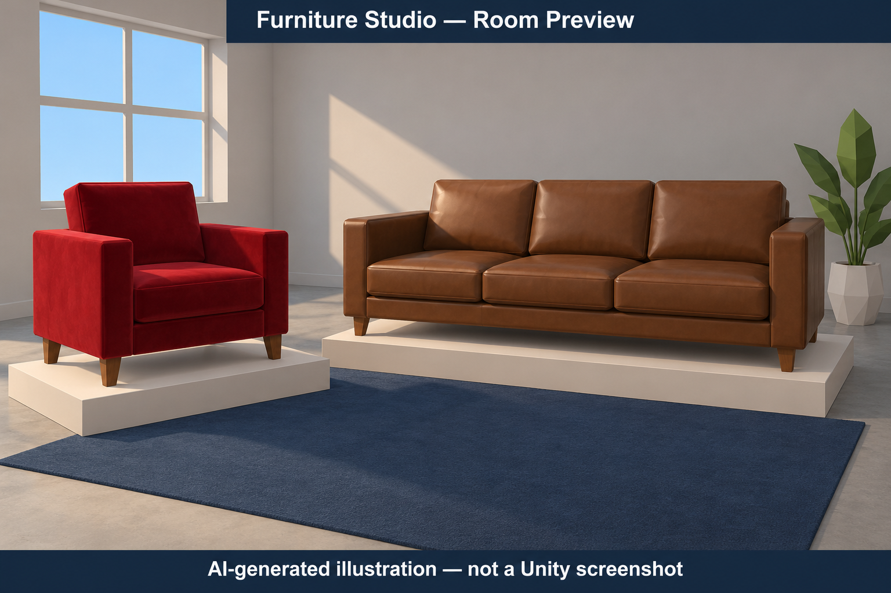

# Furniture Studio — CGVR CIE3

**Munnaluri Rishikesh · 1RVU23CSE291 · CS4104**  
Case Study 3: Retail and Remote Commerce · **Unity 6000.3.0f1**

Continues the supplied `CASE_STUDY_CIE3_UNITY_DRAFT_HANDOFF.zip`: the prepared room/furniture generator, Phong shader, UI and editor scripts are retained and completed.

## Generated visual previews

These **AI-generated illustrations are not Unity screenshots or runtime evidence**. They illustrate the room and leather-material concept; geometry, lighting and detail may differ from the actual project. Real Play-mode captures remain pending.




## Open and run

1. Download this repository and extract it. In **Unity Hub → Add → Add project from disk**, select `CASE STUDY CIE3/Unity_Retail_AR_Demo` (the folder containing `Assets`, `Packages`, `ProjectSettings`).
2. Open with **6000.3.0f1**. This is a **Built-in Render Pipeline** project; no URP conversion or external assets are needed.
3. Let Unity import. The saved scene opens when starting in an empty editor. Otherwise choose **CGVR CIE3 → Open Furniture Visualizer**, or double-click `Assets/Scenes/CIE3_Retail_Furniture_Visualizer.unity`.
4. Press **Play** and use the **Game** tab. The room, red chair, leather sofa, textures, cameras and UI are generated at runtime. A sparse hierarchy before Play is intentional. Use **CGVR CIE3 → Maximize Game View**, then press **P** for presentation mode. **Restore Game View** returns to the normal editor layout (or focus the docked Game tab and press **Shift + Space**).

The scene is already included in Build Settings. If the scene is accidentally removed, **CGVR CIE3 → Rebuild Furniture Scene** recreates it. Unity generates its local import cache and any additional default settings on first open.

## Presentation update (18 October 2026)

Update the existing project files, let Unity recompile, and press Play in the same scene. **No scene rebuild, new project, asset import or package change is required.**

- The existing chair, sofa and platforms sit closer together. A lower three-quarter camera angle frames both furniture items from their renderer bounds, including after resizing or rotating.
- Controls use a single **Lighting / Materials / Mapping** panel. Wide Game views place it on the left; narrower views place a scrollable panel below the scene. The camera uses a separate rectangle so controls cannot cover the furniture.
- **Present (P)** expands the furniture view and hides the detailed panels. Selection, Focus and Room buttons remain available, along with all lighting/material hotkeys. **P** or **Escape** shows controls again; **V** directly opens Mapping.
- Scroll zoom stops at a safe fit to keep the active furniture fully visible. Use **Focus (F)** for a large view of the selected item; **Room (R)** brings both back.
- Warmer room colors, matte environment materials, finer procedural leather grain, restrained highlights, ambient room fill, soft cast shadows and 4x MSAA improve the existing scene without added packages. The original Phong shader and mapping formula are retained.
- Inset viewport applies while Mapping is visible. Presentation mode uses the large view. Reset restores the normal viewport.

## Show faculty in two minutes

| Concept | Demonstration |
|---|---|
| **Phong illumination** | Press **1**, **2**, **3**: ambient only → ambient + diffuse → ambient + diffuse + specular. Adjust daylight and sofa specular sliders; orbit to see view-dependent highlights. |
| **Texture mapping** | Select **Sofa**, click **Focus (F)**, then toggle **T**. Color detail comes from the procedural UV texture. |
| **Bump mapping** | In lighting mode **3**, toggle **B** and orbit. The independent normal map changes shading without modifying geometry or silhouette. It also works with color texture off. |
| **Window-to-viewport** | Enable the mapping panel with **V**. Move Logical X/Y sliders. The phone marker and exact pixel values update. **Reset point** shows `(0.25, -0.30) → (657.5, 708.0)`. |
| **Actual camera viewport** | Click **Inset camera viewport / Fill camera viewport**. The rendered room occupies a smaller/larger screen rectangle. The orange screen marker and “Screen point” use the same formula with `Camera.pixelRect`. |

The phone example maps `[-1,1] × [-1,1]` to X `70..1010`, Y `120..1800`. Its coordinates are distinct from the actual Game-view camera coordinates. Both use a bottom-left origin; the IMGUI marker flips Y for top-left drawing.

```text
Phong: I = Ia*ka + Ip*(kd*max(N·L,0) + ks*max(R·V,0)^n)
xv = xv_min + (xw-xw_min) * viewport_width / window_width
yv = yv_min + (yw-yw_min) * viewport_height / window_height
```

## Controls

- Drag **inside the room view**: orbit. Scroll there: zoom.
- Select chair/sofa, then **Left / Right**: rotate the selected object.
- **F** or Focus: close-up. **R** or Room: fit both furniture items and reset orbit, zoom and inset.
- **P**: presentation mode. **Escape**: show controls. **Tab**: switch chair/sofa selection.
- **1/2/3**: lighting; **T**: texture; **B**: bump; **V**: mapping panel.
- Sliders and buttons remain independent of camera dragging. The panel reflows and scrolls instead of shrinking text to fit; desktop landscape is recommended. Very small docked views benefit from the Maximize Game View menu.

## Project contents

- `Assets/Scripts/RetailARCaseStudyDemo.cs`: existing procedural showroom plus interaction, independently controlled texture/bump, mapping and camera viewport.
- `Assets/Shaders/PhongFurniture.shader`: explicit ambient/diffuse/specular and raw RGB normal-map decoding.
- `Assets/Scenes/CIE3_Retail_Furniture_Visualizer.unity`: saved launch scene with script and shader references.
- `Assets/Editor/`: existing open/rebuild and optional mapping-validation menus, plus Maximize/Restore Game View.
- `Packages/manifest.json`: the existing working Unity built-in module list, unchanged by this update. The controller uses the built-in legacy Input API; no separate inputlegacy package is required.
- `ProjectSettings/`: editor version, input/window defaults and enabled scene.
- All source assets have stable `.meta` files. No Library/Temp cache is committed.

## Screenshots and verification

The project owner confirmed on **18 October 2026** that the previous version runs in **Unity 6000.3.0f1** and displays the room, chair, sofa and demonstration panels.

**This presentation update still needs a local Play-mode check.** Unity Editor is unavailable in the preparation environment, so the new framing, materials, controls and maximize menu have not been observed running here. Source/layout and camera-math checks are not a substitute for Unity rendering. No formal test suite, CI or deployment was added. No Unity screenshots are claimed or fabricated.

Quick local check: open the existing scene, Play, resize the Game view, switch the three tabs, press P/Escape, select/focus each item, orbit/scroll/reset, and check 1/2/3, T/B, V, Reset point and the inset viewport. Check the Console for errors and try Maximize/Restore Game View.

Capture real screenshots locally from the Game tab (Windows **Win + Shift + S**): the room; lighting modes 1 and 3; sofa with bump off/on; mapping at the reset point and inset camera. Save them under `Screenshots/` if submitting evidence. No screenshot placeholders are presented as results.

If controls do not respond after changing project settings, restore **Edit → Project Settings → Player → Other Settings → Active Input Handling → Input Manager (Old)** and restart if prompted. The supplied settings already select that input mode.

This is a desktop 3D demonstration of retail AR/VR graphics concepts, not device-tracked AR or a WebXR deployment. The existing Python report and notebook in the parent folder remain available as supplementary coursework.
