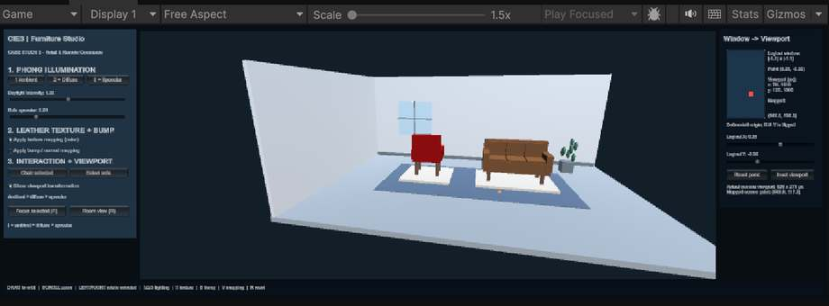
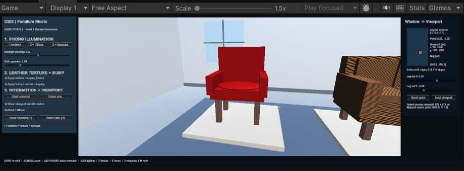

# Unity CIE3 — screenshot capture checklist

[← Case-study hub](../README.md) · [Unity guide](../Unity_Retail_AR_Demo/README.md) · [Evidence status](../../docs/EVIDENCE_STATUS.md)

This folder is reserved for **genuine captures of the Unity Game view in Play mode**. Do not replace screenshots with AI-generated illustrations, Python plots, or mobile-browser output.

**Current repo state:** Two cropped, authentic JPEGs from the **18 October 2026 earlier Unity Play-mode build** are committed below. The nine detailed comparison PNGs are still pending and the earlier screenshots do **not** verify newer presentation improvements.

| Authentic earlier-build room overview | Authentic earlier-build close-up |
|:---:|:---:|
| [](unity_room_earlier_build.jpg) | [](unity_closeup_earlier_build.jpg) |

These are **Game-view crops** of the user's real Unity Editor screenshots, compressed to JPEG for README display. Original PNGs remain in the user's provided evidence; they are not generated or rendered mockups.

## Capture settings

1. Open the project with **Unity 6000.3.0f1** and press **Play**.
2. Maximize the Game tab (**Shift + Space**) and use a readable landscape aspect ratio.
3. Keep the camera/view consistent for side-by-side mode comparisons.
4. Capture as unmodified PNG using **Win + Shift + S**, a Game-view capture, or an equivalent legitimate screen capture.
5. Save the files into this folder; then add them to the README and faculty report with honest captions.

| Filename | Demonstration | Evidence requirement |
|---|---|---|
| `unity_01_room_overview.png` | Full room, **R**, Phong mode 3 | Chair and sofa both visible |
| `unity_02_phong_ambient.png` | Press **1** | Ambient-only lighting |
| `unity_03_phong_full.png` | Press **3** | Combined ambient/diffuse/specular |
| `unity_04_sofa_texture_off.png` | Focus sofa, **T** off | Albedo detail disabled |
| `unity_05_sofa_texture_on.png` | Same angle, **T** on | Albedo detail enabled |
| `unity_06_sofa_bump_off.png` | Same angle, **B** off | Flat/smoother normals |
| `unity_07_sofa_bump_on.png` | Same angle, **B** on | Material micro-detail shading |
| `unity_08_viewport_mapping.png` | Mapping panel, Reset point | `(0.25,-0.30)→(657.5,708.0)` visible |
| `unity_09_inset_viewport.png` | Inset viewport enabled | Actual camera view rectangle changes |

Capture the full-room view plus at least the most illustrative mode comparison if time is limited. Do not claim all nine exist until they have been committed.

## How to embed a capture once it exists

Use this relative link in the **parent case-study README** only after the PNG has been added:

```markdown

```

The example above is **not an active image link** because the PNG has not yet been added. Do not rename the illustrations in [Previews](../Previews/README.md) as evidence.
