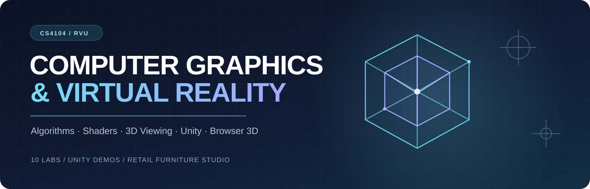
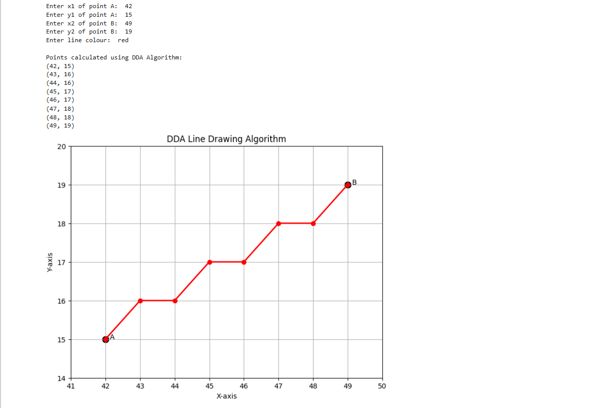
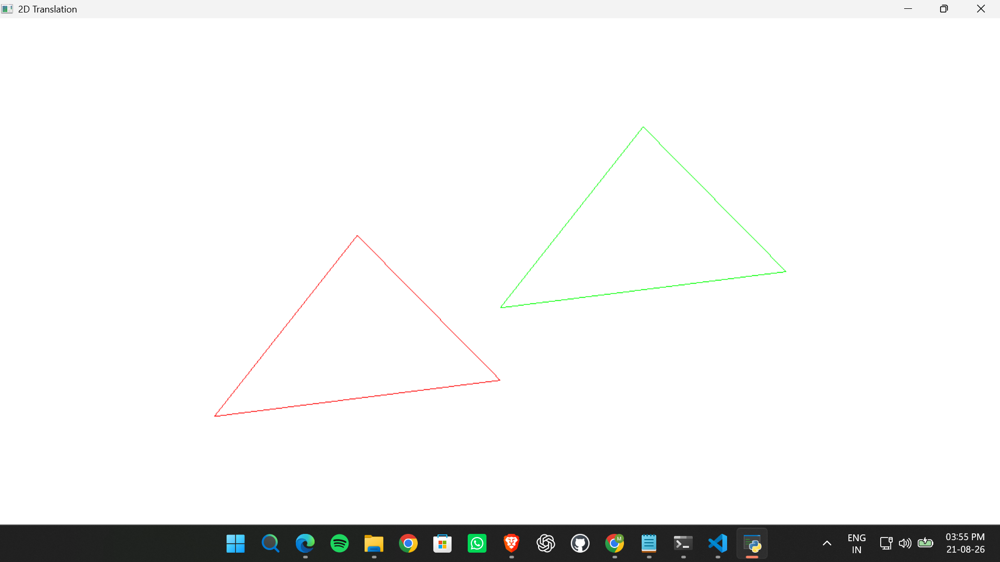
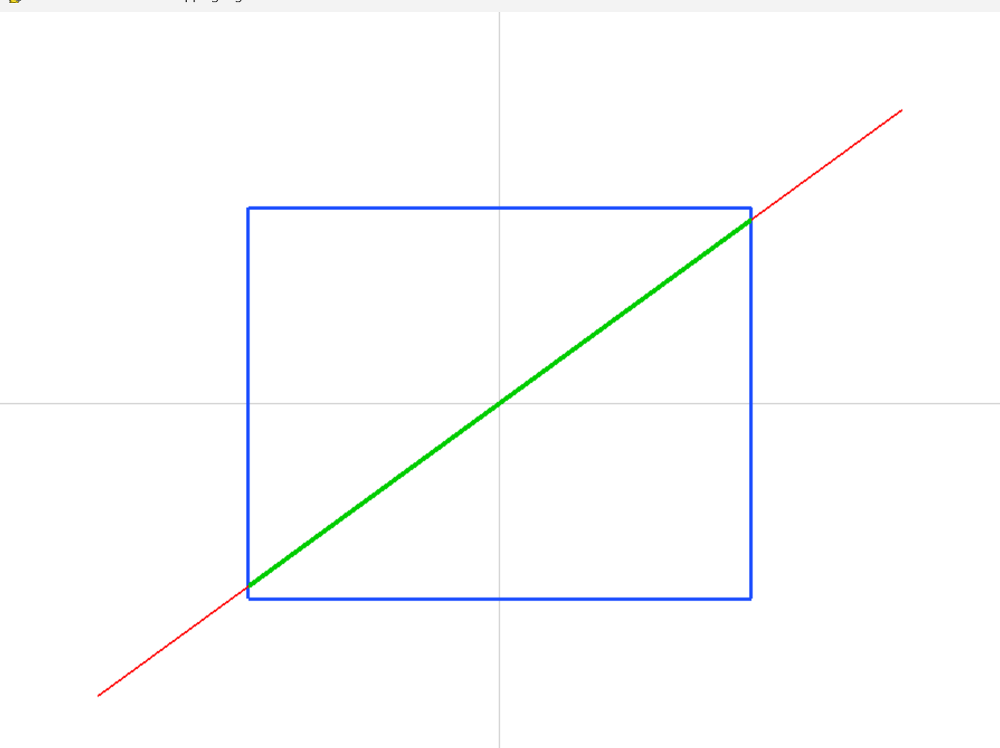
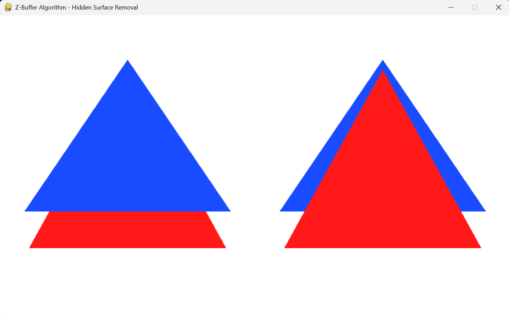

<p align="center"></p>

<p align="center">
  <a href="https://cgvr-furniture-studio.vercel.app/"></a>
  <a href="CASE%20STUDY%20CIE3/README.md"></a>
  <a href="docs/SCREENSHOT_GALLERY.md"></a>
</p>

<p align="center"><strong>A complete, lab-by-lab exploration of rasterization, transformations, rendering and 3D interaction.</strong><br>
Python & OpenGL experiments · Unity 6 projects · A responsive browser furniture showroom</p>

<p align="center">
<a href="#featured-project">Featured project</a> ·
<a href="#laboratory-index">10 labs</a> ·
<a href="#output-gallery">Outputs</a> ·
<a href="#getting-started">Get started</a> ·
<a href="#repository-guide">Repository guide</a>
</p>

---

## Featured project

### Furniture Studio · CGVR CIE3

**Case Study 3 — Retail and Remote Commerce** explores the graphics behind a virtual furniture preview: lighting a red chair, giving a leather sofa surface detail, and mapping interaction coordinates to a phone-sized viewport.

| **Open the mobile-browser experience** | **Explore the Unity project** |
|:---|:---|
| **[Launch Furniture Studio ↗](https://cgvr-furniture-studio.vercel.app/)** | **[Unity 6000.3.0f1 source →](CASE%20STUDY%20CIE3/Unity_Retail_AR_Demo/)** |
| Touch orbit, pinch zoom, change lighting, textures and viewport mapping. | A desktop 3D demonstration using procedural furniture and a custom Phong-style shader. |

[Read the case study](CASE%20STUDY%20CIE3/README.md) · [Unity setup](CASE%20STUDY%20CIE3/Unity_Retail_AR_Demo/README.md) · [Mobile-web source](CASE%20STUDY%20CIE3/mobile-web/README.md)

> **Scope:** These are educational 3D demonstrations of graphics principles—not live-camera AR, tracked WebXR or headset integrations. The desktop Unity demo was observed running locally by the project owner; later modifications and new Unity labs require separate runtime verification.

### Unity Furniture Studio — actual earlier-build screenshots

| Genuine Unity showroom | Genuine Unity close-up |
|:---:|:---:|
| [](CASE%20STUDY%20CIE3/outputs/unity_room_overview_earlier_build.jpg) | [](CASE%20STUDY%20CIE3/outputs/unity_furniture_closeup_earlier_build.jpg) |

<sub>Actual cropped screenshots from the project owner's **18 October 2026** Unity Play-mode session. These show the earlier functioning build, not completed tests of subsequent UI updates.</sub>

## Laboratory index

| Lab | Experiment | Implementation | Output |
|:---:|---|---|---|
| **[01](lab1/README.md)** | DDA & Bresenham line drawing | Python / Pygame | [Screenshots](lab1/README.md#captured-outputs) |
| **[02](lab2/README.md)** | Midpoint circle algorithm | Python / Pygame | [Screenshot](lab2/README.md#captured-outputs) |
| **[03](lab3/README.md)** | 2D geometric transformations | Python / NumPy / Pygame | [Screenshot](lab3/README.md#captured-outputs) |
| **[04](lab4/README.md)** | Composite transformation matrices | Python / NumPy / Pygame | Screenshot pending |
| **[05](lab5/README.md)** | Cohen–Sutherland line clipping | Python / PyOpenGL | [Screenshot](lab5/README.md#captured-outputs) |
| **[06](lab6/README.md)** | Z-buffer & visibility | Python / PyOpenGL | [Screenshot](lab6/README.md#captured-outputs) |
| **[07](lab7/README.md)** | Phong illumination model | Python / PyOpenGL | [Screenshot](lab7/README.md#captured-outputs) |
| **[08](lab8/README.md)** | Vertex & fragment shaders | Python / GLSL **+ Unity** | [OpenGL output](lab8/README.md#captured-outputs) |
| **[09](lab9/README.md)** | Interactive Unity 3D scene | Unity / C# | Unity capture pending |
| **[10](lab10/README.md)** | 3D viewing pipeline | Python / PyOpenGL **+ Unity** | [OpenGL outputs](lab10/README.md#captured-outputs) |

Each lab has a short explanation, source links, execution instructions and any available genuine output. **Original programs and notebooks are preserved.**

## Output gallery

The images below are existing screenshots included in the repository from the original lab projects. They are **not mocked-up visuals or Unity screenshots**.

| Line drawing · Lab 01 | Circle drawing · Lab 02 |
|:---:|:---:|
|  |  |
| 2D transforms · Lab 03 | Clipping · Lab 05 |
|  |  |
| Depth buffering · Lab 06 | Phong lighting · Lab 07 |
|  |  |
| Vertex / fragment shaders · Lab 08 | 3D viewing · Lab 10 |
|  |  |

**[Browse all 12 captured lab screenshots →](docs/SCREENSHOT_GALLERY.md)**  
For verified Unity earlier-build images and forthcoming browser screenshots, see the [screenshot gallery](docs/SCREENSHOT_GALLERY.md) and [evidence checklist](docs/EVIDENCE_STATUS.md). No unverified renders are presented as test results.

## Getting started

### Run a Python/OpenGL lab

Clone the repository and install the Python dependencies:

```bash
git clone https://github.com/Rishikeshsanin/Computer-Graphics-and-Virtual-Reality.git
cd Computer-Graphics-and-Virtual-Reality
python -m pip install -r requirements.txt

# A 2D Pygame example
python lab1/dda_line_lab1.py

# An OpenGL example
python lab7/phong_illumination_lab7.py
```

Use a Python environment with a desktop graphical display and working OpenGL drivers. For more commands, see the [setup guide](docs/GETTING_STARTED.md).

### Open a Unity project

**Unity Editor 6000.3.0f1** is used for the CIE3, Lab 8 and Lab 10 projects. In **Unity Hub → Add project from disk**, select the exact project folder—not the repository root:

| Unity project | Directory |
|---|---|
| **CIE3 furniture visualizer** | [`CASE STUDY CIE3/Unity_Retail_AR_Demo`](CASE%20STUDY%20CIE3/Unity_Retail_AR_Demo/) |
| **Lab 8 shader demo** | [`lab8/Unity_Vertex_Fragment_Shaders`](lab8/Unity_Vertex_Fragment_Shaders/) |
| **Lab 10 dual-camera demo** | [`lab10/Unity_3D_Viewing_Pipeline`](lab10/Unity_3D_Viewing_Pipeline/) |

Open the saved scene and press **Play**. The scenes construct their demo objects at runtime. Lab 9 retains its original [standalone Unity repository](https://github.com/Rishikeshsanin/unity-interactive-3d-scene) and a source copy here.

## Repository guide

| Resource | Description |
|---|---|
| [Case-study hub](CASE%20STUDY%20CIE3/README.md) | Faculty scenario, implementation, calculations and evidence |
| [Mobile browser app](CASE%20STUDY%20CIE3/mobile-web/README.md) | Live Three.js furniture studio; touch interaction |
| [Getting started](docs/GETTING_STARTED.md) | Python and Unity environment setup |
| [Screenshot gallery](docs/SCREENSHOT_GALLERY.md) | All 12 original lab-output images |
| [Evidence status](docs/EVIDENCE_STATUS.md) | Which Unity/mobile captures are still required |
| [Source repositories](SOURCE_REPOS.md) | Provenance of consolidated lab files |

### Toolchain

`Python` · `NumPy` · `Pygame` · `PyOpenGL` · `GLSL` · `Jupyter` · `Unity / C#` · `Three.js`

---

<p align="center"><strong>Munnaluri Rishikesh</strong> · CS4104 Computer Graphics & Virtual Reality · RV University, Bengaluru<br>
Academic laboratory portfolio — explanations, code and evidence presented separately.</p>
