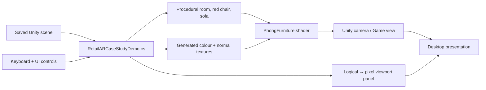
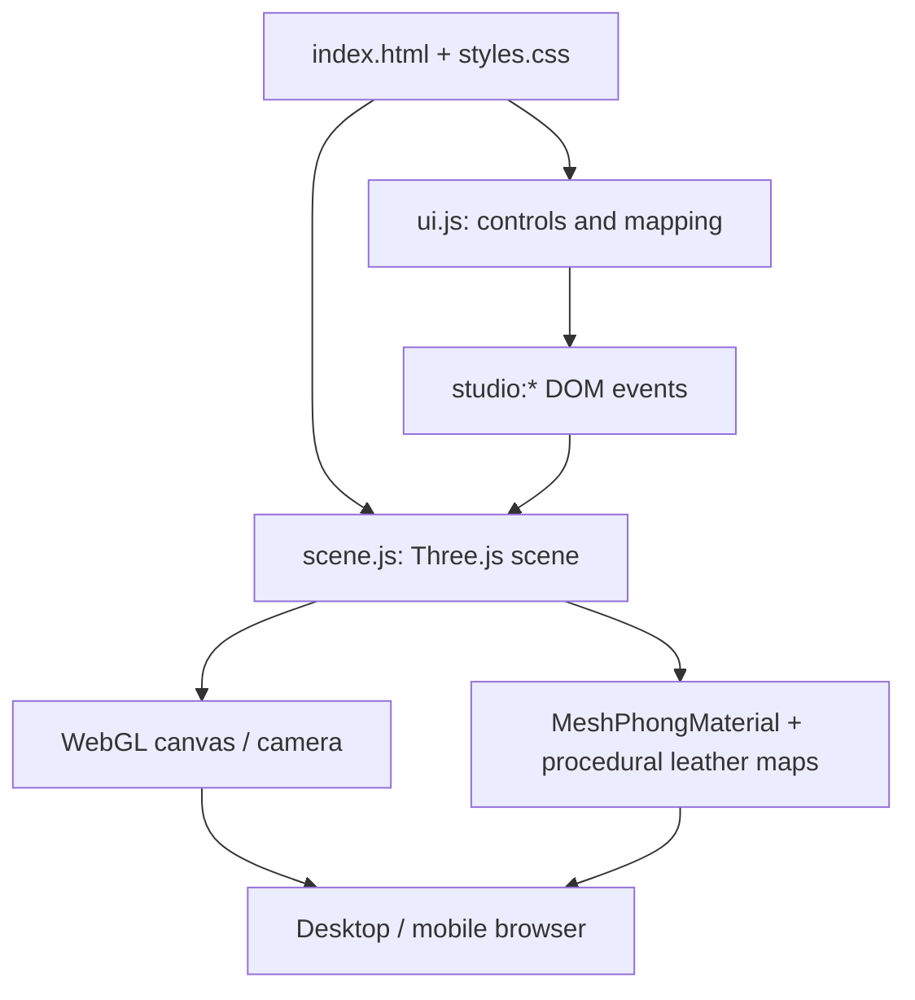

[← Manual](MANUAL.md) · [Case study](../CASE%20STUDY%20CIE3/README.md) · [Source provenance](../SOURCE_REPOS.md)

# Architecture & Code Map

This repository is an **educational monorepo**, not one coupled production application. Its parts can be opened and run independently.

## Repository composition

```text
Computer-Graphics-and-Virtual-Reality/
├── README.md                   ← entry point and visual index
├── docs/                       ← manual, gallery, theory, setup and evidence
├── lab1/ ... lab7/             ← Python/Pygame/OpenGL exercises
├── lab8/
│   ├── *_lab8.py / .ipynb      ← GLSL / PyOpenGL triangle
│   └── Unity_Vertex_Fragment_Shaders/
│       ├── Assets/Scenes/     ← saved Unity entry scene
│       ├── Assets/Scripts/    ← rotation and UI logic
│       └── Assets/Shaders/    ← GPU shader
├── lab9/                       ← retained Unity C# source archive
├── lab10/
│   ├── *_lab10.py / .ipynb     ← dual viewport OpenGL cube
│   └── Unity_3D_Viewing_Pipeline/
│       ├── Assets/Scenes/     ← saved Unity entry scene
│       ├── Assets/Scripts/    ← cube/cameras and controls
│       └── Assets/Shaders/    ← vertex-colour shader
└── CASE STUDY CIE3/
    ├── Unity_Retail_AR_Demo/   ← desktop CGVR case study
    │   ├── Assets/Scenes/
    │   ├── Assets/Scripts/
    │   ├── Assets/Shaders/
    │   └── Assets/Editor/
    ├── mobile-web/             ← deployed HTML/CSS/Three.js companion
    ├── outputs/                ← genuine earlier Unity screenshots + capture guide
    └── Previews/               ← AI concept art; NOT app output
```

## Rendering and interaction pipeline


The stages are related but separate:

- **Rasterization:** Labs 1–2 choose pixels from geometric definitions.
- **Transforms + clipping:** Labs 3–5 change coordinates or restrict visible geometry.
- **Visibility + shading:** Labs 6–8 compare depths, reflectance and programmable shader stages.
- **Camera + interaction:** Labs 9–10 and CIE3 connect transforms, user input, rendering and pixel-space viewports.

## CIE3 — Unity runtime flow



| Component | Location | Responsibility |
|---|---|---|
| Saved scene | [CIE3_Retail_Furniture_Visualizer.unity](../CASE%20STUDY%20CIE3/Unity_Retail_AR_Demo/Assets/Scenes/CIE3_Retail_Furniture_Visualizer.unity) | Entry point before pressing Play |
| App logic | [RetailARCaseStudyDemo.cs](../CASE%20STUDY%20CIE3/Unity_Retail_AR_Demo/Assets/Scripts/RetailARCaseStudyDemo.cs) | Procedural geometry, camera, GUI, illumination settings, coordinate mapping |
| Lighting shader | [PhongFurniture.shader](../CASE%20STUDY%20CIE3/Unity_Retail_AR_Demo/Assets/Shaders/PhongFurniture.shader) | Per-fragment ambient/diffuse/specular, colour texture, tangent-space normal map |
| Editor utilities | [Assets/Editor](../CASE%20STUDY%20CIE3/Unity_Retail_AR_Demo/Assets/Editor/) | Open/validate scene via Unity Editor menus |
| Packaging | [Packages/manifest.json](../CASE%20STUDY%20CIE3/Unity_Retail_AR_Demo/Packages/manifest.json) | Unity project dependencies |

**Rendering note:** the shader is a teaching implementation of a Phong-style fragment lighting model. A runtime-generated normal texture perturbs shading normals; it does not physically modify the sofa geometry.

## CIE3 — Mobile/desktop browser flow



| File | Responsibility |
|---|---|
| [index.html](../CASE%20STUDY%20CIE3/mobile-web/index.html) | Semantic panels, buttons and accessibility labels |
| [styles.css](../CASE%20STUDY%20CIE3/mobile-web/styles.css) | Responsive layout and presentation |
| [ui.js](../CASE%20STUDY%20CIE3/mobile-web/ui.js) | Tabs, focus, controls and phone-coordinate mathematics |
| [scene.js](../CASE%20STUDY%20CIE3/mobile-web/scene.js) | Camera, room meshes, lights, shadows, albedo and bump maps, gestures |

Unlike Unity, this browser companion uses **Three.js materials and WebGL**, not the project's Unity ShaderLab program. It does **not** need a database or a backend, and it does not turn the camera on.

## Unity Lab 8 vs Lab 10

| Lab | Core scene | GPU focus | Main visual |
|---|---|---|---|
| [8](../lab8/Unity_Vertex_Fragment_Shaders/README.md) | Runtime-generated RGB triangle | Vertex rotation + fragment interpolation | Rotating coloured triangle |
| [10](../lab10/Unity_3D_Viewing_Pipeline/README.md) | Shared cube, two cameras | Two projection matrices / viewports | Orthographic left, perspective right |

For both, open the **inner** project directory through Unity Hub. A blank/no-camera Game tab **before Play** is expected because the runtime script creates the demonstration cameras.

## Source integrity & ownership

The docs and galleries are separate from application code. Existing Python labs, the Unity CIE3 application and browser source should not be modified as part of a documentation-only update. See [SOURCE_REPOS.md](../SOURCE_REPOS.md) for upstream lab origins and the [evidence ledger](EVIDENCE_STATUS.md) for runtime limitations.
