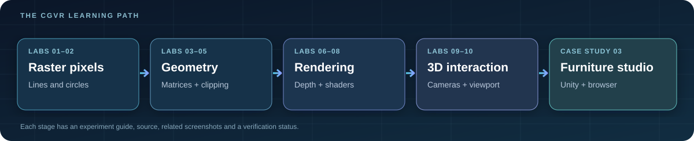

[← Repository](../README.md) · [Theory](GRAPHICS_THEORY.md) · [Illustrated gallery](SCREENSHOT_GALLERY.md) · [Live showroom ↗](https://cgvr-furniture-studio.vercel.app/)

# CGVR · The Technical Manual

**CS4104 · Computer Graphics & Virtual Reality**  
**Munnaluri Rishikesh · RV University · Academic lab and case-study reference**

> **Start here.** This is the central navigation page for the repository. Every experiment has an objective, a short algorithm explanation, runnable source, evidence, interpretation, and next steps. The case study adds a complete Unity demo and a web-based companion.

## Choose your path

| I want to… | Start here | What I'll find |
|---|---|---|
| Understand the entire project in 3 minutes | [Repository overview](../README.md) | 10 experiments, CIE3, screenshots and live site |
| Learn the graphics concepts | [Graphics theory](GRAPHICS_THEORY.md) | Algorithms, matrices, lighting, shaders, projection and equations |
| Run a particular experiment | [Experiments 01–10](#part-i--laboratory-programs) | Objective → code → execution → output → interpretation |
| Open the Unity furniture demo | [CIE3 desktop guide](../CASE%20STUDY%20CIE3/Unity_Retail_AR_Demo/README.md) | Unity version, saved scene, controls and three graphics outcomes |
| Try the phone-compatible website | [Live Furniture Studio ↗](https://cgvr-furniture-studio.vercel.app/) | Interactive showroom and touch controls |
| Present this to faculty | [Demonstration guide](DEMONSTRATION_GUIDE.md) | Talking points, exact controls, evidence and honest limitations |
| Find the screenshots | [Visual gallery](SCREENSHOT_GALLERY.md) | Original OpenGL/Pygame images and earlier-build Unity captures |
| Debug setup or crashes | [Troubleshooting](TROUBLESHOOTING.md) | Python, OpenGL, Unity and web diagnostics |
| See what has genuinely been tested | [Evidence ledger](EVIDENCE_STATUS.md) | Clearly separated captured, source-only and pending results |

## At a glance

| Collection | Coverage | Where it lives |
|---|---|---|
| **Fundamentals** | Raster lines/circles, transformations, clipping | [Labs 1–5](#part-i--laboratory-programs) |
| **Rendering** | Depth buffer, illumination, GPU shaders | [Labs 6–8](#part-i--laboratory-programs) |
| **3D interaction** | Player movement, model/view/projection, viewport | [Labs 9–10](#part-i--laboratory-programs) |
| **Integrated project** | Furniture, custom Phong shader, materials, viewport | [CIE3 Case Study](../CASE%20STUDY%20CIE3/README.md) |
| **Web companion** | Touch-based 3D in desktop and mobile browsers | [Hosted demo ↗](https://cgvr-furniture-studio.vercel.app/) |

## The journey from pixels to 3D

The labs are intentionally cumulative. Early programs show *where pixels should be drawn*. Mid-course labs transform and clip geometry. Rendering labs decide *which surfaces and colours remain visible*. Unity and the browser demo combine lighting, geometry, camera movement and interface coordinates.

## Part I — Laboratory programs

| Chapter | Subject | Source | Output and key observation |
|---|---|---|---|
| [**01 — DDA & Bresenham**](../lab1/README.md) | Floating-point vs integer line rasterization | Two Python programs | [4 source screenshots](../lab1/README.md#captured-outputs) · compare raster points |
| [**02 — Midpoint circle**](../lab2/README.md) | Symmetry and decision variable | Python | [Circle capture](../lab2/README.md#captured-outputs) · eight octants |
| [**03 — 2D transformations**](../lab3/README.md) | Translation, rotation, scale, reflection, shear | Python + NumPy | [Translation capture](../lab3/README.md#captured-outputs) · matrix effect |
| [**04 — Composite transforms**](../lab4/README.md) | Order of 3×3 transforms | Python + NumPy | Source present; output screenshot pending |
| [**05 — Line clipping**](../lab5/README.md) | Cohen–Sutherland outcodes | PyOpenGL | [Clipping capture](../lab5/README.md#captured-outputs) |
| [**06 — Z-buffer**](../lab6/README.md) | Visibility/occlusion | PyOpenGL | [Depth comparison](../lab6/README.md#captured-outputs) |
| [**07 — Phong model**](../lab7/README.md) | Ambient/diffuse/specular light | PyOpenGL | [Lighting result](../lab7/README.md#captured-outputs) |
| [**08 — Vertex + fragment shaders**](../lab8/README.md) | GPU stages, colour interpolation | OpenGL + **Unity** | [GL output](../lab8/README.md#captured-outputs); Unity capture pending |
| [**09 — Interactive scene**](../lab9/README.md) | Input, collision, collecting, camera | Unity C# | Lab 9 source copy; runnable [standalone project ↗](https://github.com/Rishikeshsanin/unity-interactive-3d-scene) |
| [**10 — Viewing pipeline**](../lab10/README.md) | Model/view/projection and viewports | OpenGL + **Unity** | [2 GL outputs](../lab10/README.md#captured-outputs); Unity capture pending |

## Part II — The integrated furniture case study

The [CIE3 furniture project](../CASE%20STUDY%20CIE3/README.md) demonstrates the three questions requested in the faculty brief:

1. **Phong illumination:** What do ambient, diffuse and specular lighting contribute to the appearance of a red chair?
2. **UV texture and bump mapping:** How can a leather sofa gain apparent detail without adding polygons?
3. **Window-to-viewport transformation:** How do logical coordinates convert into pixels on a phone-sized viewport?

There are **two independent implementations**:

| Unity desktop | Web browser |
|---|---|
| Unity 6000.3.0f1, C#, custom shader, saved scene | Three.js 0.186.1, HTML, CSS and JavaScript |
| [Open Unity guide](../CASE%20STUDY%20CIE3/Unity_Retail_AR_Demo/README.md) | [Run the deployed site ↗](https://cgvr-furniture-studio.vercel.app/) |
| Desktop Play-mode evidence exists for an older build | Deployed page and static assets were reachable; phone hardware test still unverified |

**Neither version currently implements physical camera-based AR, SLAM, headset tracking or a production WebXR session.** The scene intentionally illustrates the graphics foundations behind those systems.

## Part III — Setup & demonstration

**Python / OpenGL:** [Getting started](GETTING_STARTED.md) → install dependencies → run a chosen lab separately → compare its actual output to the corresponding figure.

**Unity:** Add one exact project folder in Unity Hub → open its saved scene → press Play → read its lab-specific controls. The CIE3, Lab 8 and Lab 10 scenes create their visual demo objects during Play mode.

**Web:** [Open the public showroom](https://cgvr-furniture-studio.vercel.app/) or serve the `mobile-web` folder via HTTP for local development.

**Faculty presentation:** Use [the step-by-step demonstration guide](DEMONSTRATION_GUIDE.md) and keep any screenshot comparisons at matching angles and input settings.

## Part IV — Reference desk

| Reference | Purpose |
|---|---|
| [Architecture & implementation map](ARCHITECTURE.md) | Where each project, shader and pipeline stage lives |
| [Graphics theory & formula sheet](GRAPHICS_THEORY.md) | Equations and short worked examples for all experiments |
| [Demonstration guide](DEMONSTRATION_GUIDE.md) | A short, coherent practical walkthrough |
| [Troubleshooting](TROUBLESHOOTING.md) | Recovering from common errors |
| [Glossary](GLOSSARY.md) | Definitions of CGVR terminology |
| [Genuine screenshots](SCREENSHOT_GALLERY.md) | Carefully labeled visual evidence |
| [Evidence ledger](EVIDENCE_STATUS.md) | What is captured vs not yet validated |
| [Source repositories](../SOURCE_REPOS.md) | Origin of consolidated standalone experiments |

### Reading the evidence correctly

`Python / OpenGL screenshot` ≠ `Unity screenshot` ≠ `browser screenshot` ≠ `AI concept illustration`.

The gallery keeps these separate. An image is not proof of performance measurements, a new build, a mobile hardware run, or a feature it does not depict.

---

[↑ Back to top](#cgvr--the-technical-manual) · [Repository](../README.md) · [Continue to theory →](GRAPHICS_THEORY.md)
