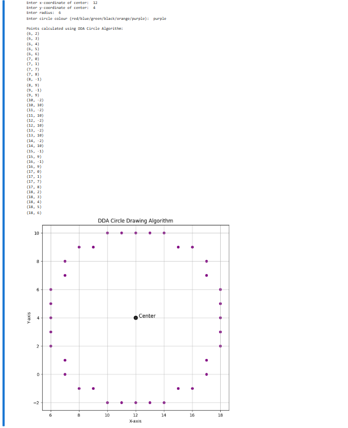
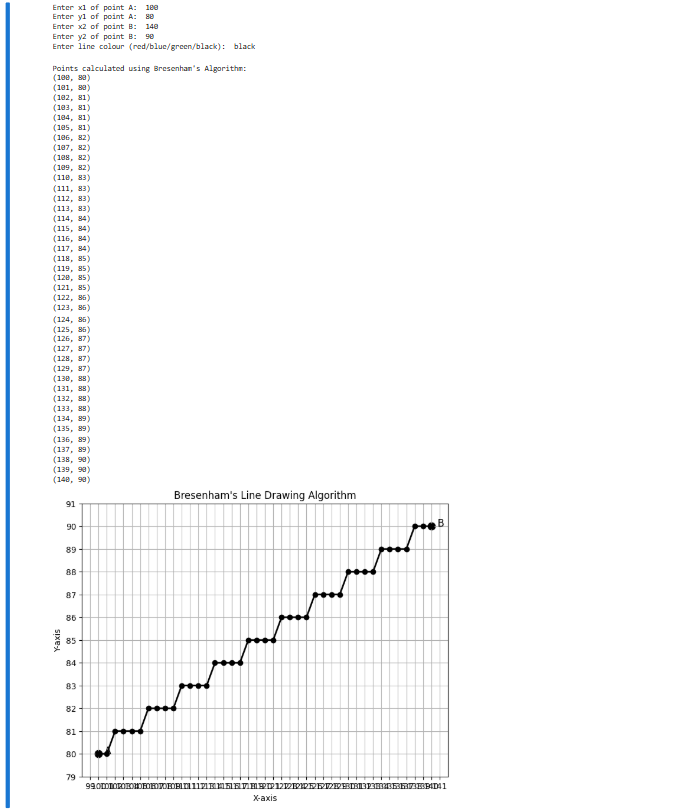
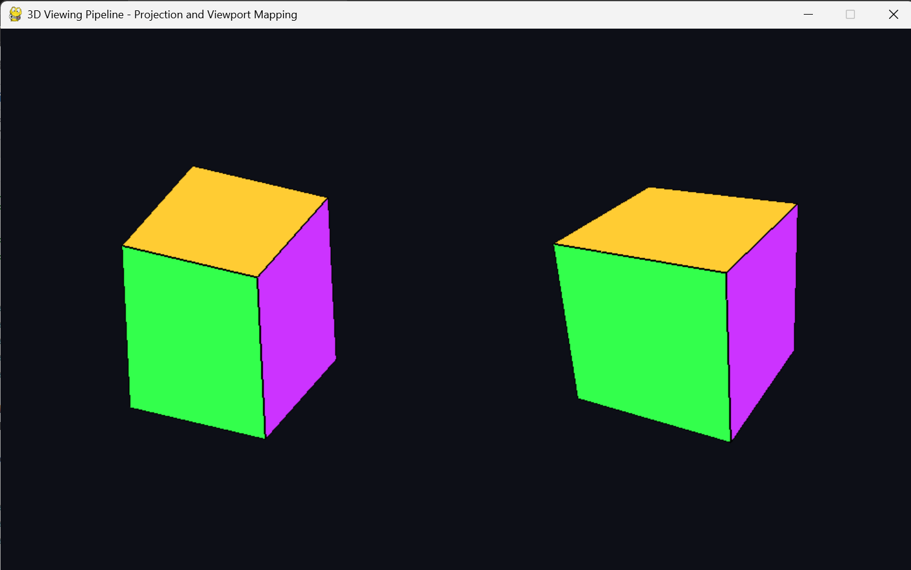

# Captured output gallery

[← Repository](../README.md) · [Evidence status](EVIDENCE_STATUS.md)

These **12 PNGs already exist in the lab folders** and were carried over from the source experiments. They document Python/Pygame or PyOpenGL output, not newly captured Unity or mobile browser sessions.

| No. | Experiment | Screenshot |
|:---:|---|---|
| 01A | DDA — output 1 |  |
| 01B | DDA — output 2 |  |
| 01C | Bresenham — output 1 |  |
| 01D | Bresenham — output 2 |  |
| 02 | Midpoint circle |  |
| 03 | 2D translation |  |
| 05 | Cohen–Sutherland clipping |  |
| 06 | Z-buffer |  |
| 07 | Phong illumination |  |
| 08 | Vertex and fragment shaders, **OpenGL** |  |
| 10A | 3D viewing pipeline, **OpenGL**, output 1 |  |
| 10B | 3D viewing pipeline, **OpenGL**, output 2 |  |

## Captures still needed

There is no committed screenshot for Lab 4, Lab 9, the **Unity** versions of Labs 8 and 10, the **Unity** CIE3 play session, or the mobile browser site. The separate CIE3 `Previews/` images are AI concept illustrations and must not be labeled as application output.

Use the exact [capture instructions](EVIDENCE_STATUS.md) and replace pending notes only once files exist.

## Authenticity

Never use generated promotional artwork as proof that an application ran. A screenshot title must identify the **correct implementation** (OpenGL, Unity or browser). For original lab-image provenance, consult [SOURCE_REPOS.md](../SOURCE_REPOS.md).
